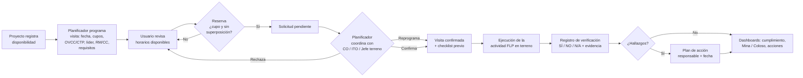

# Safety Planner — Field Leadership Program

Prototipo funcional (MVP demostrable) de **planificación, agendamiento y liderazgo en terreno** para el Field Leadership Program de Minera Escondida.
Un único proyecto React con dos experiencias independientes:

| Experiencia | Ruta | Enfoque |
|---|---|---|
| **Plataforma Web** | `/web` | Administración, planificación, calendario, reservas, dashboards y seguimiento de acciones |
| **Aplicación Móvil** | `/app` | Explorar proyectos, reservar visitas, checklist previo, verificación en terreno y acciones |

> ⚠️ **Modo demostración.** Todos los datos son ficticios. La autenticación es **simulada** (no es un mecanismo de seguridad) y la persistencia es local al navegador (LocalStorage). La carga de evidencias es simulada: solo se registra el nombre del archivo; nada se sube ni se almacena.

---

## 1. Requisitos e instalación

- Node.js 22 o superior (probado con Node 25) y npm.

```bash
npm install
npm run dev        # http://localhost:3000  (puerto estricto)
```

El servidor usa `strictPort`: si el puerto **3000** está ocupado, Vite se detiene con un error en lugar de cambiar a otro puerto. Libera el puerto (p. ej. `npx kill-port 3000`) y vuelve a ejecutar.

| Script | Descripción |
|---|---|
| `npm run dev` | Servidor de desarrollo en `http://localhost:3000` |
| `npm run build` | Chequeo TypeScript + build de producción en `dist/` |
| `npm run preview` | Sirve el build en `http://localhost:3000` |
| `npm run typecheck` | Solo verificación de tipos |
| `npm test` | Pruebas automatizadas de reglas de negocio (Vitest) |

## 2. Perfiles demo

Selecciona el perfil en el login (web o móvil). Las credenciales se completan solas; la contraseña es **`demo2026`**.

| Perfil | Persona ficticia | Correo |
|---|---|---|
| Administrador | Camila Herrera | `admin.demo@flp-escondida.demo` |
| Planificador | Rodrigo Valdés | `planificador.demo@flp-escondida.demo` |
| Usuario | Valentina Soto | `usuario.demo@flp-escondida.demo` |

- Las sesiones **web** y **móvil** son independientes (puedes estar como Administrador en web y como Usuario en móvil).
- Desde el menú de usuario (web) o la pestaña *Perfil* (móvil) puedes **cambiar de perfil** o **cerrar sesión**.
- El Administrador puede **restablecer los datos demo** (dashboard, menú de usuario o perfil móvil).
- Si abres web y móvil en pestañas distintas, los datos se sincronizan entre ellas.

## 3. Flujo principal FLP



Estados de una reserva: `pendiente → confirmada → completada` (al registrar la verificación). Alternativas: `rechazada`, `cancelada`, reprogramación (vuelve a `confirmada` en el nuevo horario).

## 4. Cómo probar el flujo completo

1. **Usuario (web o móvil)** → *Reservar visita* / *Explorar*: filtra por área, fecha, tipo (OVCC/CTP) o riesgo; abre un horario, revisa los **requisitos**, marca lo que tienes listo, acepta la declaración y confirma. La reserva queda **Pendiente**.
   - Intenta reservar un horario **sin cupos** (badge rojo) o uno que **choque** con otra visita tuya: el sistema lo impide.
2. **Planificador** → *Solicitudes*: **confirma**, **rechaza** (motivo obligatorio) o **reprograma** la solicitud. En *Programación* / *Publicar* crea un horario nuevo; el formulario detecta conflictos (mismo proyecto o mismo líder superpuesto) y valida cupos/horas.
3. **Usuario** → *Mis visitas → Por verificar*: hay una visita de hoy y una de ayer listas. Responde las 7 preguntas; si marcas **NO**, agrega comentario y completa el **plan de acción** (responsable y fecha). Al registrar, la reserva pasa a *Completada* y se crean las acciones.
4. **Administrador** → *Dashboard ejecutivo*: revisa cómo cambian completadas, cumplimiento y acciones. Filtra por **Mina / Coloso**. En *Hallazgos y acciones* cierra o reabre acciones; en *Usuarios* y *Proyectos* gestiona registros.
5. Recarga el navegador (F5): todos los cambios se mantienen. Usa *Restablecer datos demo* para volver al estado inicial.

## 5. Mapa de pantallas

**Comunes:** Landing (`/`), Login web (`/web/login`), Login móvil (`/app/login`).

**Plataforma Web (`/web/...`)**

| Pantalla | Admin | Planif. | Usuario |
|---|:-:|:-:|:-:|
| Dashboard (ejecutivo / planificación / personal) | ✔ | ✔ | ✔ |
| Proyectos + detalle con disponibilidad (`proyectos`, `proyectos/:id`) | ✔ gestiona | ✔ | ✔ reserva |
| Calendario semanal y mensual (`calendario`) | ✔ | ✔ | ✔ |
| Actividades FLP / Programación (`programacion`) | ✔ | ✔ | — |
| Solicitudes de reserva (`solicitudes`) | ✔ | ✔ | — |
| Reservar visita (`reservar`) | — | — | ✔ |
| Mis visitas + checklist + historial (`mis-visitas`) | — | — | ✔ |
| Verificación en terreno (`verificacion/:id`) | — | — | ✔ |
| Hallazgos y acciones (`acciones`) | ✔ | ✔ | ✔ propias |
| Usuarios y perfiles (`usuarios`) | ✔ | — | — |
| Flujo FLP (`flujo`) | ✔ | ✔ | ✔ |

**Aplicación Móvil (`/app/...`)** — navegación inferior distinta por rol:

- **Usuario:** Inicio · Explorar · Detalle de proyecto (selector de días) · Reserva paso a paso (`reservar/:id`) · Mis visitas · Detalle de visita + checklist previo (`visita/:id`) · Verificación (`verificar/:id`) · Acciones · Perfil y estadísticas.
- **Planificador:** Inicio (solicitudes y agenda de hoy) · Agenda · Publicar / editar disponibilidad (`disponibilidad/nueva`, `disponibilidad/:id`) · Solicitudes (confirmar, rechazar, reprogramar) · Perfil.
- **Administrador:** Panel ejecutivo con filtro por área, KPIs, gráfico y alertas · Actividades · Proyectos · Acciones · Perfil.

En escritorio la app móvil se muestra dentro de un marco de teléfono centrado con pantalla de 440 × 956 px CSS (se reduce proporcionalmente si la ventana es más baja); en un smartphone real ocupa la pantalla completa.

## 6. Arquitectura

```
src/
├─ app/          App (BrowserRouter, rutas) y guardas de sesión/rol
├─ components/   UI reutilizable (botones, badges, modales, KPI), gráficos y kit móvil
├─ contexts/     Datos (persistencia + notificaciones), sesiones por experiencia, toasts
├─ data/         Catálogos (RM, CC, requisitos, preguntas) y generador de datos demo
├─ features/     Módulos compartidos web/móvil: auth, reservas, horarios, verificación, acciones
├─ layouts/      WebLayout (sidebar), MobileLayout (tab bar), PhoneFrame
├─ pages/        web/ · mobile/ · shared/ (landing)
├─ services/     Reglas de negocio puras (flpService), indicadores (selectors), storage
├─ styles/       tokens.css (paleta y tokens de diseño) + estilos base
├─ types/        Modelo de dominio tipado
└─ utils/        Fechas (date-fns, formato chileno) y utilidades
```

- **Una sola capa de negocio** (`services/flpService.ts`): web y móvil usan las mismas funciones, por lo que cupos, superposiciones, estados y validaciones se comportan igual en ambas.
- **Tokens de diseño** en `src/styles/tokens.css` (naranja `#F15A24`, negro, grises, verde/rojo de estado, azul petróleo). Cambiar un valor ahí actualiza toda la interfaz. Los colores de series de gráficos fueron validados para daltonismo y contraste.
- **Datos demo** generados con semilla determinística y **fechas relativas a hoy**: ~5 meses de historial y 6 semanas futuras; 14 proyectos (Mina/Coloso), 8 contratistas ficticios, 9 RM y 16 CC.
- **Persistencia:** LocalStorage (`flp-escondida:data` y `flp-escondida:session:{web|mobile}`).

Stack: React 19 · TypeScript · Vite · Tailwind CSS v4 · React Router (BrowserRouter, rutas sin `#`) · Lucide · Recharts · date-fns (locale `es`, formato `dd-MM-yyyy`, semana desde el lunes) · Vitest.

## 7. Reglas de negocio implementadas

- Reservas solo en horarios publicados, futuros y de proyectos vigentes; declaración de requisitos obligatoria.
- **Sin sobrecupos:** pendientes, confirmadas y completadas ocupan cupo.
- **Sin superposición** de visitas del mismo usuario (mismo día y horario solapado).
- Programación: valida campos, horas, cupos (1–30), coherencia RM↔CC y **conflictos** de proyecto o líder; al editar, los cupos no pueden ser menores a las reservas existentes.
- Cancelar un horario cancela sus reservas activas; reprogramar verifica cupo y superposición.
- Verificación: solo la persona inscrita, con reserva confirmada y desde la hora de inicio; todas las preguntas respondidas; un **NO** exige comentario; si se requieren acciones, exige descripción, responsable y fecha compromiso (o cierre en el lugar).
- Cumplimiento = % de **SÍ** sobre respuestas aplicables (SÍ + NO).

## 8. Limitaciones conocidas (prototipo)

- Sin backend ni base de datos: los datos viven en el navegador y no se comparten entre equipos/personas.
- Autenticación simulada: no hay contraseñas reales, permisos de servidor ni auditoría.
- Evidencias simuladas: no se almacenan archivos.
- Sin notificaciones reales (correo/push); los avisos son mensajes en pantalla.
- Sin integración con sistemas corporativos (registro oficial FLP, directorio de personas, control de acceso).
- No incluye FLC de superintendentes (fuera del alcance del despliegue de referencia).
- Los significados de siglas (OVCC, CTP) y el catálogo RM/CC son representativos y deben validarse con el estándar vigente.
- El bundle de producción supera 500 kB (aviso de Vite); puede dividirse por experiencia con carga diferida si se requiere.

## 9. Validación local

Validado en esta etapa:

- `npm run typecheck` sin errores · `npm test` (12 pruebas) · `npm run build` correcto.
- Recorrido automatizado por navegador de todas las vistas (web 1440 px y 820 px, móvil 390 px y marco de escritorio) sin errores de consola.
- Flujo de extremo a extremo por la interfaz: reserva → persistencia tras recargar → confirmación del planificador → cancelación → verificación con hallazgo → acción creada.

Checklist manual sugerido:

- [ ] La landing abre en `http://localhost:3000` y muestra ambas entradas.
- [ ] Login web y login móvil son independientes; los 3 perfiles navegan en ambos.
- [ ] Reservar, ver el bloqueo por cupo/superposición, cancelar.
- [ ] Confirmar / rechazar / reprogramar como planificador.
- [ ] Publicar un horario y ver el conflicto si se repite proyecto/líder.
- [ ] Registrar una verificación con un NO y su plan de acción; ver los KPIs actualizados.
- [ ] Recargar el navegador: los cambios se mantienen. Restablecer datos demo.
- [ ] Revisar en celular real o con DevTools (modo dispositivo).

## 10. Estrategia Git (`main` / `test`)

| Rama | Propósito |
|---|---|
| `main` | Versión estable y aprobada. Fuente del despliegue oficial en GitHub Pages. Solo recibe cambios validados. |
| `test` | Desarrollo e integración. Se prueba primero en `localhost:3000`. **No despliega** al enlace oficial. |

Flujo: trabajar en `test` → validar localmente → Pull Request `test → main` → al aprobarse y fusionarse en `main`, el workflow publica en Pages.

### Publicación futura en GitHub Pages (no ejecutada)

- La app usa rutas limpias (sin `#`). Como GitHub Pages no tiene reglas de reescritura, el workflow copia `index.html` a `404.html` para que cualquier ruta abra la app. En Vercel, `vercel.json` reescribe todas las rutas a `index.html`. Los enlaces antiguos con `#/` se redirigen solos a la ruta limpia.
- `vite.config.ts` lee `BASE_PATH` (por defecto `/`). El workflow `.github/workflows/deploy-pages.yml` compila con `BASE_PATH=/<repositorio>/` y despliega **solo desde `main`**.
- `.github/workflows/ci.yml` ejecuta typecheck, pruebas y build en `test` y en Pull Requests, sin desplegar.
- Pasos cuando se apruebe la publicación: crear el repositorio remoto, `git remote add origin …`, `git push -u origin main test`, y en *Settings → Pages* elegir **GitHub Actions** como fuente.

### Información sensible

La carpeta `referencias/` (planillas y notas originales con datos personales) está **excluida** en `.gitignore`, junto con `*.xlsx`, `*.docx` y `*.pdf`. No se usaron nombres, teléfonos ni identificadores reales de esos archivos: todas las personas y empresas del prototipo son ficticias.
